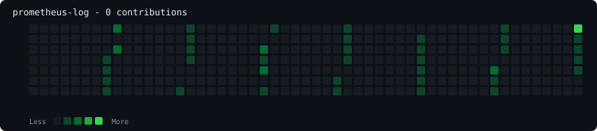

### `yourname@github ~ $ ./contributions.sh`

  

### `yourname@github ~ $ whoami`

<table>
<tr>
<td valign="top"></td>
<td valign="top"></td>
</tr>
</table>

## Setup

1. Create a public repository named exactly your GitHub username.
2. Install Python 3.11+ and dependencies: `pip install -r scripts/requirements.txt`
3. This project includes your supplied image as `portrait.jpg`. Generate the portrait SVG:
   `python scripts/prep_photo.py portrait.jpg`
   `python scripts/make_ascii_svg.py`
4. Set profile details in environment variables if desired, then run `python scripts/make_info_card.py`.
5. Set `GITHUB_USERNAME` to your username, then run:
   `python scripts/fetch_contributions.py`
   `python scripts/render_heatmap_svg.py`
6. Commit and push the generated SVGs and workflow to the `main` branch. GitHub Actions refreshes the heatmap daily.

The portrait scripts run locally when your photo changes. The workflow only updates the contribution heatmap. GitHub may change the public contribution HTML markup, in which case the scraper may need updating.
